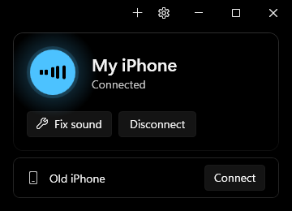
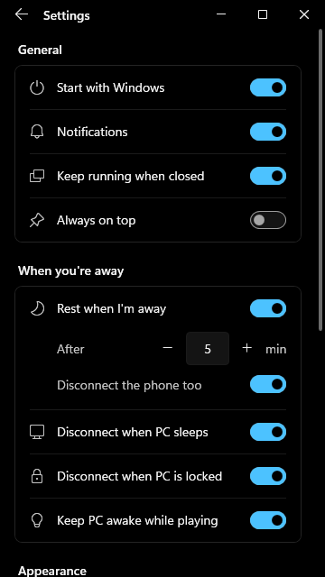

# BlueAux

**Turn your Windows PC into a Bluetooth speaker for your phone.**

Play Spotify, YouTube, podcasts or anything else on your phone and hear it through your PC's speakers or headphones. Like a car stereo, it connects by itself whenever your phone is nearby.

  
  &nbsp;&nbsp;&nbsp;
  

  <a href="https://github.com/HobaOwO/BlueAux/releases/latest/download/BlueAux.exe"><b>⬇ Download BlueAux.exe</b></a> 
  Free · open source · one file, nothing to install · no account · no ads

## Why BlueAux

Windows can already receive Bluetooth audio, but there's no good way to use it: other apps make you press **Connect** every time, and often sit there "connected" with no sound.

- 🔁 **Connects by itself** when your phone is in range, and again when you come back.
- 🔊 **Fixes "connected but no sound".** It can tell a dead connection from a paused phone and repairs it before you notice. On an iPhone it also knows when you press play or a volume button and nothing comes through.
- 🎵 **Shows what's playing** on your iPhone, with album art and a spinning record.
- 🎨 **Four themes:** Windows, OLED (true black), Graphite and Paper, all in your accent colour. Animations can be turned off.
- 🔒 **Respects your privacy.** Lets go of the phone when the PC is locked or goes to sleep, and rests when you're away.
- 🪶 **Light.** One small file and 10–20 MB of memory in the tray.

## Get started

1. **Pair your phone once:** on the PC, **Settings → Bluetooth & devices → Add device**, pick your phone.
2. **[Download BlueAux.exe](https://github.com/HobaOwO/BlueAux/releases/latest/download/BlueAux.exe)**, put it somewhere you'll keep it (your Documents folder is fine) and run it.
   If Windows says *"Windows protected your PC"*, click **More info → Run anyway**. That warning appears for any app without a paid signing certificate.
3. Click **Yes, start with Windows** so it's always ready.

Play something on your phone and it comes out of your PC.

**Needs** Windows 10 (2004 or newer) or Windows 11 with Bluetooth. Made for iPhones; Android phones should work too but are less tested ([tell us how it goes](https://github.com/HobaOwO/BlueAux/issues)).

## Settings

| | |
|---|---|
| **General** | Start with Windows · notifications · keep running when closed · always on top |
| **When you're away** | Rest after N minutes idle (optionally disconnect the phone too) · disconnect when the PC sleeps · disconnect when the PC is locked · keep the PC awake while playing |
| **Appearance** | Theme: Windows, OLED, Graphite, Paper · animations on/off · album art on/off · plain tray icon |
| **Connect automatically** | Choose which phones connect by themselves; hide the ones you don't use |

## Questions

**It says connected, but there's no sound.**
BlueAux usually fixes this on its own within a few seconds. If it doesn't: check that the PC isn't muted (the app warns you), then press play on the phone and click **Fix sound**. On an iPhone, pressing a volume button while it's silent also triggers the fix. If it happens often, please [report it](https://github.com/HobaOwO/BlueAux/issues) with your logs.

**How does it know what my iPhone is playing?**
iPhones tell paired accessories what they play, the same way they tell car stereos and watches. Windows usually sets that up when you pair the phone; if yours didn't, BlueAux shows **Set up** under the phone: hold the unlocked iPhone next to the PC and tap **Pair** when it asks. If that doesn't work (common with older iPhones such as the 6, and with some PCs), BlueAux then shows the PC in the iPhone's **Settings → Bluetooth**: tap it there and pair. Once. Apps such as TikTok don't share what they play, so no song shows for them.

**Where does the album art come from?**
An iPhone sends only the title and artist, so BlueAux looks the cover up in Apple's iTunes catalogue (Deezer as a fallback). That's the one thing it sends anywhere; turn **Album art** off in Settings and it sends nothing at all.

**Which speakers does it use?**
Windows' default output. Switch it from the speaker icon in the taskbar, or **Settings → More → Sound settings** in the app.

**Can I change the volume from my phone?** Yes, the phone's volume and the PC's both work.

**Does it handle phone calls?** No, only media audio.

**How do I connect a second phone?** Pair it in Windows; it shows up under **Other devices** with a **Connect** button.

**How do I quit or uninstall it?** Right-click the tray icon and choose **Exit**. To uninstall, turn off **Start with Windows**, delete `BlueAux.exe` and the folder `%AppData%\BlueAux`.

**Where are the logs?** **Settings → More → Open log folder**. `activity.log` lists connections; `sound-check.log` shows what the sound watcher saw. Attach both when reporting a problem; song names are never written to them.

## For developers

BlueAux is one small C# / WPF app on Windows' own Bluetooth audio receiver (`Windows.Media.Audio.AudioPlaybackConnection`), with no libraries. [docs/how-it-works.md](docs/how-it-works.md) explains the Windows and iPhone quirks it works around and how the UI is built; [docs/silent-connection-review.md](docs/silent-connection-review.md) is the investigation behind the "connected but silent" fixes.

**Build:** run `build.cmd`. It uses the C# compiler that ships with Windows (.NET Framework 4.8), so there's nothing to install. The app lands in `bin\BlueAux.exe`.

Bug reports, test results from other phones and pull requests are welcome.

## License

[MIT](LICENSE)
