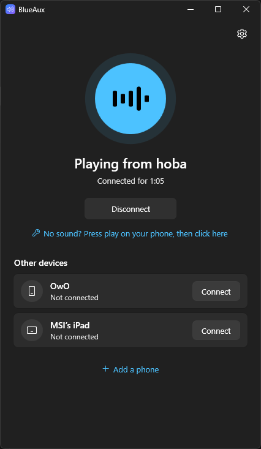
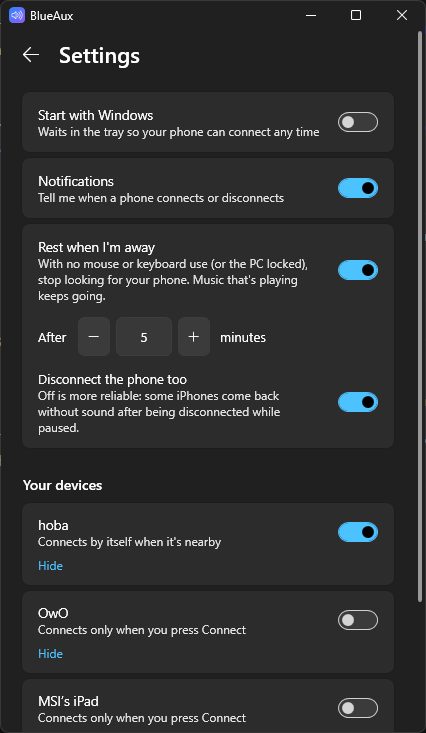

# BlueAux

**Turn your Windows PC into a Bluetooth speaker for your phone.**

Play Spotify, YouTube, podcasts or anything else on your phone and hear it through your PC's speakers or headphones. Like a car stereo, it connects by itself whenever your phone is nearby.

  
  &nbsp;&nbsp;
  

  <a href="https://github.com/HobaOwO/BlueAux/releases/latest/download/BlueAux.exe"><b>⬇ Download for Windows</b></a>
  &nbsp;·&nbsp; free · open source · no install · no account · no ads

## Why?

Windows can play your phone's audio, but there's no easy way to use that. Other apps make you press **Connect** every single time, and often end up "connected" with no sound at all.

BlueAux fixes both:

- 🔁 **Connects automatically** when your phone is in range, and reconnects when you come back.
- 🔊 **Fixes "connected but no sound".** When your phone comes back, the first connection Windows makes often has no sound. BlueAux reconnects once by itself, so the music plays when you press play.
- 🪶 **Light.** One small file, nothing to install, and only 10–20 MB of memory in the tray.
- 😴 **Rests when you're away.** It stops searching when nobody's using the PC, and starts again when you're back.
- 🌗 **Looks at home on Windows 11**, in light and dark mode.

## Get started

1. **Pair your phone once.** On your PC open **Settings → Bluetooth & devices → Add device**, then pick your phone.
2. **[Download BlueAux.exe](https://github.com/HobaOwO/BlueAux/releases/latest/download/BlueAux.exe)**. Put it somewhere you'll keep it, such as your Documents folder, and run it.
   - If Windows says *"Windows protected your PC"*, click **More info**, then **Run anyway**. This shows up for apps that aren't signed with a paid certificate.
3. Click **Yes, start with Windows** so it's always ready.

That's it. Play something on your phone and it comes out of your PC.

**Needs:** Windows 10 (version 2004 or newer) or Windows 11, with Bluetooth. Works with iPhone. Android phones should work too, but they haven't been tested yet ([tell us how it goes](https://github.com/HobaOwO/BlueAux/issues)).

## Questions

**It says connected, but there's no sound.**
BlueAux usually fixes this by itself: a few seconds after connecting, it reconnects once if no sound has come through yet. If it still happens, first check that your PC isn't muted (the app warns you when it is). Then press play on your phone and click **No sound? Press play on your phone, then click here**, or click the "connected" notification. If you see this often, please [report it](https://github.com/HobaOwO/BlueAux/issues) and attach your logs (see below).

**Which speakers does it use?**
Windows' default output. To switch, click the speaker icon in the taskbar, or open **Settings → More options → Sound settings** in the app.

**Can I change the volume from my phone?**
Yes. Your phone's volume and the PC's volume both work.

**Does it handle phone calls?**
No, only media audio such as music and videos.

**How do I connect a different phone?**
Pair it in Windows first. It then shows up under **Other devices**, where you click **Connect**. You can choose which phones connect by themselves in Settings.

**Does it connect to the internet?**
No. It never sends anything anywhere. The only links that go online are **Open on GitHub** and **Report a problem**, and those open in your browser.

**How do I quit or uninstall it?**
Right-click the icon in the taskbar tray and choose **Exit**. To uninstall it, turn off **Start with Windows**, delete `BlueAux.exe`, and delete the folder `%AppData%\BlueAux`.

**Where are the logs?**
In the app, open **Settings → More options → Open log folder**. `activity.log` shows connections, and `sound-check.log` shows sound levels while a phone is connected. Please attach both when reporting a problem.

## For developers

BlueAux is a small C# / WPF app built on Windows' own Bluetooth audio receiver (`Windows.Media.Audio.AudioPlaybackConnection`). [docs/how-it-works.md](docs/how-it-works.md) covers the Windows and iPhone quirks it works around.

**Build:** run `build.cmd`. It uses the C# compiler that ships with Windows (.NET Framework 4.8), so you don't need Visual Studio or any SDK. The app is written to `bin\BlueAux.exe`.

Contributions, bug reports and test results from other phones are very welcome.

## License

[MIT](LICENSE)
